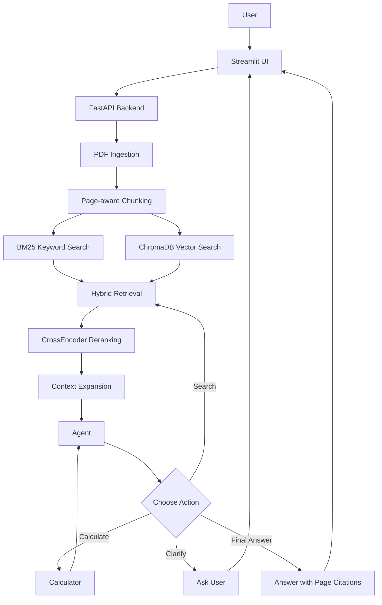

# Agentic RAG Document Q&A System

An Agentic Retrieval-Augmented Generation (RAG) system that answers questions about financial reports and user-uploaded PDF documents. It combines hybrid retrieval, document-grounded reasoning, calculator-based arithmetic, and page-level citations to provide answers supported by the source document.

## Features

- **Agentic workflow:** An LLM agent decides whether to search the document, perform a calculation, ask a clarification question, or provide a final answer.
- **Hybrid retrieval:** Combines BM25 keyword search with sentence-transformer vector search.
- **Cross-encoder reranking:** Ranks retrieved chunks by relevance before providing them to the agent.
- **Page-aware chunking:** Preserves PDF page information for source references.
- **Context expansion:** Retrieves neighboring chunks to help recover context such as financial table headers.
- **Document-grounded answers:** Instructs the agent to use only retrieved document content and refuse unsupported questions.
- **PDF uploads:** Supports uploading and indexing additional PDF documents.
- **Conversation memory:** Retains recent exchanges to support follow-up questions.
- **API and monitoring:** FastAPI endpoints provide document upload, question answering, health status, and usage metrics.
- **Docker support:** Separate containers for the API and Streamlit interface.

## Architecture



## Agent Workflow

The agent operates through a controlled action loop:

| Action | Purpose |
|---|---|
| `search_document` | Searches the document for relevant evidence |
| `calculator` | Performs arithmetic using a restricted mathematical expression |
| `ask_user` | Requests clarification when a question is ambiguous |
| `final_answer` | Returns an answer based on retrieved sources |

The workflow includes limits on the number of steps and searches, duplicate-search prevention, and validation of cited source indices.

## Technology Stack

| Component | Technology |
|---|---|
| Language | Python |
| LLM API | Groq |
| Embeddings | Sentence Transformers – `all-MiniLM-L6-v2` |
| Vector Database | ChromaDB |
| Keyword Retrieval | BM25 |
| Reranking | CrossEncoder – `cross-encoder/ms-marco-MiniLM-L-6-v2` |
| Backend | FastAPI |
| Frontend | Streamlit |
| PDF Processing | pypdf |
| Deployment | Docker and Docker Compose |

## Project Structure

```text
agentic-rag-v2/
│
├── agent.py                 # Agent action loop and decision handling
├── answer.py                # LLM configuration and document setup
├── api.py                   # FastAPI endpoints
├── chat.py                  # Command-line chat interface
├── eval.py                  # Answer and retrieval evaluation
├── index.py                 # ChromaDB vector indexing
├── ingest.py                # PDF extraction and page-aware chunking
├── pipeline.py              # Pipeline for uploaded PDFs
├── retrieve.py               # Hybrid retrieval and reranking
├── search.py                 # BM25 keyword search
├── ui.py                     # Streamlit user interface
│
├── test_retrieval.py         # Retrieval inspection tests
├── inspect_chunk.py          # Chunk inspection utility
├── llm_test.py               # LLM connectivity test
│
├── Dockerfile                # API container
├── Dockerfile.ui             # Streamlit container
├── docker-compose.yml        # Multi-container setup
│
├── requirements.txt          # Backend dependencies
├── requirements-ui.txt       # Frontend dependencies
│
├── data/
│   └── tesla.pdf             # Built-in financial document (add locally)
│
└── .env                      # API configuration (create locally; do not commit)
```

## Setup and Installation

### 1. Clone the repository

```bash
git clone <YOUR_REPOSITORY_URL>
cd agentic-rag-v2
```

### 2. Create a virtual environment

```bash
python -m venv venv
```

Activate it on Windows:

```powershell
venv\Scripts\activate
```

### 3. Install dependencies

```bash
pip install -r requirements.txt
pip install -r requirements-ui.txt
```

### 4. Configure environment variables

Create a `.env` file in the project root:

```env
GROQ_API_KEY=your_groq_api_key
LLM_MODEL=openai/gpt-oss-120b
```

An optional setting is:

```env
REASONING_EFFORT=low
```

Never commit your `.env` file or expose your API key.

### 5. Add the built-in PDF

Create a `data` directory and place the built-in financial PDF at:

```text
data/tesla.pdf
```

The current code uses this document when no uploaded document is selected.

### 6. Start the FastAPI backend

```bash
uvicorn api:app --reload
```

The API runs at:

```text
http://localhost:8000
```

Interactive API documentation:

```text
http://localhost:8000/docs
```

### 7. Start the Streamlit frontend

Open another terminal, activate the virtual environment, and run:

```bash
streamlit run ui.py
```

The interface runs at:

```text
http://localhost:8501
```

## Docker Deployment

Make sure the required `data/tesla.pdf` file and `.env` configuration are present.

Build and start both services:

```bash
docker compose up --build
```

The services are available at:

- Streamlit UI: `http://localhost:8501`
- FastAPI backend: `http://localhost:8000`
- API documentation: `http://localhost:8000/docs`

The Docker setup uses separate API and UI containers. The API image includes the embedding and reranking models, and Docker Compose defines a persistent volume for the ChromaDB index.

## API Endpoints

| Method | Endpoint | Description |
|---|---|---|
| GET | `/health` | Checks API and pipeline status |
| GET | `/metrics` | Returns request, latency, token, and session metrics |
| POST | `/upload` | Uploads and indexes a PDF |
| POST | `/ask` | Sends a question to the document agent |

### Example question request

```json
{
  "question": "What was Tesla's effective tax rate in 2025?",
  "session_id": null,
  "doc_id": null
}
```

For an uploaded document, pass the `doc_id` returned by `/upload`.

## Evaluation

The project includes an evaluation harness in `eval.py`.

It contains nine test cases divided into:

- **Answer tests:** Financial questions with expected numerical answers.
- **Refusal tests:** Questions about information that should not be available in the document.

The evaluation script checks answer correctness and whether expected phrases appear in the chunks retrieved and supplied to the agent. It also records retrieved chunk IDs, pages, latency, token usage, and errors in `eval_report.json`.

Run the evaluation:

```bash
python eval.py
```

Run only one split:

```bash
python eval.py --split dev
```

```bash
python eval.py --split held_out
```

Evaluation results depend on the availability and rate limits of the configured LLM API.

## Future Improvements

- Expand evaluation coverage across more financial documents.
- Improve answer and citation verification.
- Add support for more document formats.
- Improve retrieval efficiency and reduce LLM token usage.
- Add more robust automated testing and deployment workflows.

## Author

**Rohan Bhoyar**  
B.Tech – Artificial Intelligence and Data Science

Developed as a project exploring Agentic AI, Retrieval-Augmented Generation, hybrid search, and document-grounded question answering.
